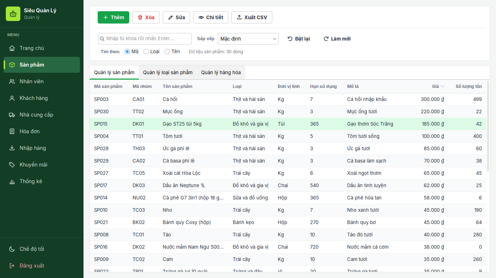
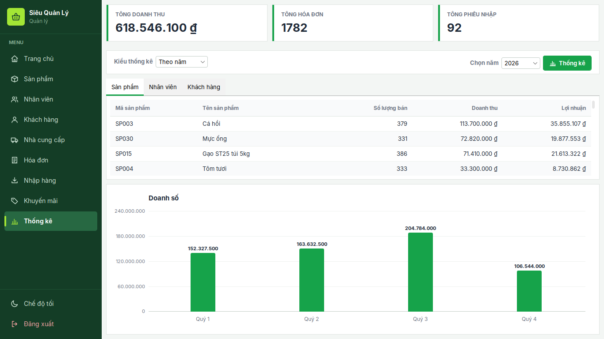
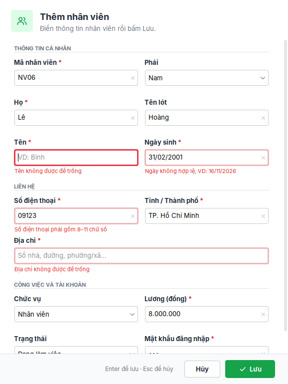

# 🛒 HỆ THỐNG QUẢN LÝ CỬA HÀNG THỰC PHẨM

Ứng dụng desktop (Java Swing + PostgreSQL) hỗ trợ cửa hàng thực phẩm quản lý bán hàng, kho hàng và nhân sự một cách chính xác, nhanh chóng, giảm sai sót so với quản lý thủ công.


---

## 👨‍💻 Thành viên nhóm

| Họ tên              | MSSV       |
| ------------------- | ---------- |
| Nguyễn Trọng Nguyễn | 3124410242 |
| Phạm Thị Hải Yến    | 3124410418 |
| Lê Hữu Nam          | 3123410227 |
| Trần Ngọc Thái Sơn  | 3122410361 |
| Lê Hoàng Thuận      | 3124560088 |
| Phan Tiến Đạt       | 3124410066 |

---

## 🚀 Chức năng chính

**Nghiệp vụ**

* Quản lý sản phẩm, loại sản phẩm, hàng hóa / kho
* Quản lý khách hàng, nhân viên, nhà cung cấp
* Lập hóa đơn bán hàng (tự trừ tồn kho, kiểm tra điều kiện khuyến mãi)
* Lập phiếu nhập hàng
* Quản lý chương trình khuyến mãi
* Thống kê doanh thu theo năm / quý, theo sản phẩm, nhân viên, khách hàng
* Xuất hóa đơn, phiếu nhập ra PDF; xuất bảng ra CSV (mở được bằng Excel)
* Phân quyền: **Quản lý** dùng toàn bộ chức năng, **Nhân viên** chỉ bán hàng, nhập hàng, tra cứu

**Trải nghiệm**

* Trang chủ có số liệu: doanh thu hôm nay / tháng này, cảnh báo **sắp hết hàng** và **lô hàng sắp hết hạn**
* Chế độ **sáng / tối**, nhớ lựa chọn cho lần mở sau
* Bảng: bấm tiêu đề cột để sắp xếp, bấm đúp vào dòng để sửa, phím Delete để xóa
* Hộp thoại Thêm/Sửa báo lỗi ngay dưới ô nhập sai; nhập ngày `dd/MM/yyyy`, tiền `8.000.000`
* Tìm kiếm không phân biệt hoa/thường và dấu (gõ "sua" vẫn ra "Sữa")
* Thông báo dạng toast tự ẩn; xuất file xong có nút "Mở file"
* Tải dữ liệu ở luồng nền, hiện "Đang tải…" thay vì đứng hình

---

## 📸 Giao diện

| Đăng nhập | Sản phẩm (sắp xếp theo giá) |
| --- | --- |
|  |  |
| **Hóa đơn** | **Thống kê** |
|  |  |
| **Hộp thoại kiểm tra dữ liệu** | **Chế độ tối** |
|  |  |

---

## ⚙️ Công nghệ sử dụng

* Java 17+ · Java Swing · [FlatLaf](https://www.formdev.com/flatlaf/) (giao diện hiện đại, sáng/tối)
* PostgreSQL 16 chạy bằng Docker · JDBC
* iText 5 (xuất PDF)

Các thư viện `.jar` đã có sẵn trong thư mục `lib/`, không cần tải thêm.

---

## ⚡ Chạy nhanh (Windows)

Yêu cầu: **JDK 17 trở lên** và **Docker Desktop** đang mở.

1. Clone project:
   ```bash
   git clone https://github.com/OwenDepTry/he-thong-quan-ly-cua-hang-thuc-pham
   ```
2. Bấm đúp **`chay.bat`**.

Lần đầu, script sẽ tự đóng gói ứng dụng, bật PostgreSQL bằng Docker (tự tạo database và nạp dữ liệu mẫu), chờ sẵn sàng rồi mở ứng dụng. Những lần sau chỉ cần bấm đúp `chay.bat` là xong.

### 📦 Dữ liệu mẫu

Database mới tạo đã có sẵn dữ liệu để dùng thử ngay, không cần nhập tay:
30 sản phẩm, 30 khách hàng, 7 nhân viên, 7 nhà cung cấp, 7 khuyến mãi, khoảng **2.000 hóa đơn** và 100 phiếu nhập
trải đều **12 tháng gần nhất tính tới hôm nay**, kèm vài sản phẩm sắp hết hàng và lô hàng sắp hết hạn để Trang chủ có cảnh báo.

* Đã có database từ trước (không muốn mất dữ liệu đã nhập)? Bấm đúp **`nap-du-lieu-mau.bat`**. Chạy lại nhiều lần cũng không bị nhân đôi.
* Muốn làm lại từ đầu với ngày tháng mới: `docker compose down -v` rồi `docker compose up -d`.
* Script nằm ở `sql/zz_du_lieu_mau.sql`.

> macOS / Linux: chạy `./chay.sh`.

### 🔑 Tài khoản demo

| Vai trò   | Tài khoản | Mật khẩu |
| --------- | --------- | -------- |
| Quản lý   | admin     | admin    |
| Nhân viên | nhanvien  | 123      |
| Nhân viên mẫu | NV01, NV02, NV03 | 123 |
| Quản lý mẫu | NV04 | 123 |

---

## 🛠️ Chạy từ VS Code / IDE (dành cho lập trình)

1. Bật database: mở Docker Desktop, ở thư mục project chạy
   ```bash
   docker compose up -d
   ```
2. Mở project bằng VS Code (hoặc IntelliJ / NetBeans / Eclipse), thêm các file trong `lib/` vào classpath
   (VS Code đã cấu hình sẵn `lib/**/*.jar`).
3. Chạy `src/main/Main.java`.

Kết nối mặc định khớp với `docker-compose.yml`: cổng **55432**, user `postgres`, mật khẩu `postgres`.
Muốn đổi thì chép `db.properties.example` thành `db.properties` rồi sửa (file này không bị đẩy lên GitHub).

### Đóng gói

`build.bat` (Windows) hoặc `./build.sh` (macOS/Linux) tạo **`dist/QuanLyCuaHang.jar`**: một file duy nhất đã gộp sẵn mọi thư viện, chạy bằng `java -jar dist/QuanLyCuaHang.jar`.

### Lệnh Docker hay dùng

| Việc | Lệnh |
| --- | --- |
| Bật database | `docker compose up -d` |
| Xem trạng thái (phải là `healthy`) | `docker compose ps` |
| Tắt database | `docker compose stop` |
| Xóa sạch dữ liệu, nạp lại dữ liệu mẫu | `docker compose down -v` rồi `docker compose up -d` |

---

## 🗂️ Cấu trúc thư mục

```
📦 he-thong-quan-ly-cua-hang-thuc-pham
 ┣ 📂 src
 ┃ ┣ 📂 config      kết nối CSDL (DBConnection)
 ┃ ┣ 📂 dao         truy vấn CSDL
 ┃ ┣ 📂 entity      lớp dữ liệu
 ┃ ┣ 📂 images      ảnh dùng trong giao diện
 ┃ ┗ 📂 main        Main.java – điểm khởi động
 ┣ 📂 ui            giao diện Swing (màn hình, hộp thoại, thành phần dùng chung)
 ┣ 📂 sql           script tạo CSDL + dữ liệu mẫu zz_du_lieu_mau.sql (Docker tự nạp lần đầu)
 ┣ 📂 lib           thư viện .jar (FlatLaf, PostgreSQL JDBC, iText)
 ┣ 📂 docs          ảnh chụp màn hình
 ┣ 📄 docker-compose.yml
 ┣ 📄 chay.bat / chay.sh     chạy ứng dụng bằng 1 lần bấm
 ┣ 📄 nap-du-lieu-mau.bat    nạp dữ liệu mẫu vào database đang có
 ┗ 📄 build.bat / build.sh   đóng gói thành dist/QuanLyCuaHang.jar
```

Thành phần giao diện dùng chung trong `ui/`:

| File | Vai trò |
| --- | --- |
| `AppTheme` | bảng màu sáng/tối, font, cấu hình FlatLaf |
| `AppIcons` | bộ icon vector vẽ bằng Java2D |
| `AppTable` | định dạng bảng: tiền `125.000 ₫`, ngày `dd/MM/yyyy`, sắp xếp theo cột |
| `FormDialog` | khung hộp thoại Thêm/Sửa có kiểm tra dữ liệu |
| `AppAsync` | chạy truy vấn ở luồng nền kèm lớp phủ "Đang tải…" |
| `Toast` | thông báo nhỏ tự ẩn |

---

## ❓ Gặp lỗi?

Khi không kết nối được CSDL, hộp thông báo trong app sẽ ghi rõ nguyên nhân và cách sửa. Một số trường hợp hay gặp:

* **Docker chưa chạy / `docker compose ps` không hiện gì** → mở Docker Desktop rồi chạy `docker compose up -d`.
* **Báo trùng cổng (`port is already allocated`)** → đổi `"55432:5432"` trong `docker-compose.yml` sang cổng khác, và tạo `db.properties` dùng cổng đó.
* **Chữ hơi mờ trên Windows** → bật ClearType (tìm "Adjust ClearType text" trong Windows).
* **Muốn có dữ liệu mẫu** → bấm đúp `nap-du-lieu-mau.bat` (giữ dữ liệu cũ), hoặc `docker compose down -v` rồi `docker compose up -d` (làm lại từ đầu).

---

## 🎯 Định hướng phát triển

* Xây dựng phiên bản web
* Phân quyền chi tiết hơn
* Tích hợp thanh toán online
* Quét mã vạch khi bán hàng

---

⭐ Nếu thấy project hữu ích hãy để lại 1 star nhé!
