# Hệ thống quản lý cửa hàng thực phẩm

[](https://github.com/OwenDepTry/he-thong-quan-ly-cua-hang-thuc-pham/actions/workflows/ci.yml)


Phần mềm quản lý cho một cửa hàng thực phẩm nhỏ: bán hàng tại quầy, nhập kho theo lô có hạn dùng, khách hàng thành viên, nhân viên và báo cáo doanh thu. Có **bản web** (Spring Boot + React) và **bản desktop** (Java Swing), dùng chung một database PostgreSQL: hóa đơn lập ở quầy trên máy tính hiện ngay trên web và ngược lại.

> **Xem thử:** _link demo sẽ cập nhật sau khi deploy_. Đăng nhập `admin` / `admin` (quản lý) hoặc `nhanvien` / `123` (nhân viên).
> Chạy trên máy chỉ cần Docker: `docker compose --profile web up -d --build` rồi mở <http://localhost:8081>.

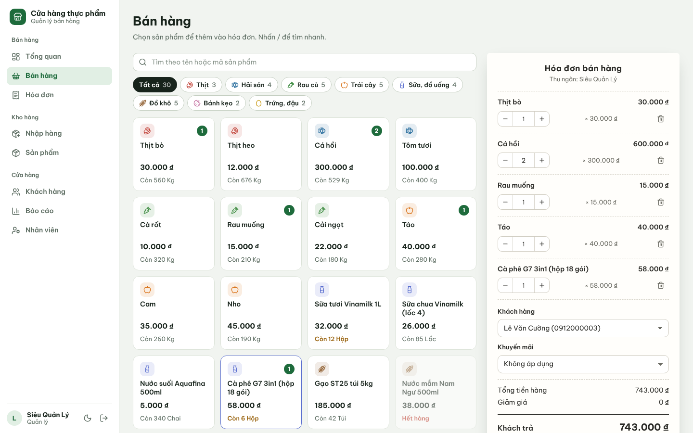

## Tính năng

**Bán hàng**
- Màn hình bán hàng có ảnh từng sản phẩm, lọc theo nhóm hàng, tìm không dấu ("sua" ra "Sữa"), phím `/` để tìm nhanh, tăng giảm số lượng ngay trên hóa đơn.
- Máy chủ tính lại tiền theo giá trong database, kiểm tra tồn kho và điều kiện khuyến mãi, ghi hóa đơn và trừ kho trong cùng một transaction.
- In hóa đơn khổ giấy in nhiệt 80 mm ngay từ trình duyệt.

**Kho hàng**
- Quản lý tải ảnh sản phẩm lên ngay trên web; ảnh được thu nhỏ trong trình duyệt rồi lưu trong database, nên deploy gói miễn phí không cần ổ đĩa.
- Lập phiếu nhập từ nhà cung cấp, cộng tồn kho. Dòng có hạn sử dụng tạo một lô hàng; hạn được gợi ý sẵn theo số ngày sử dụng của sản phẩm.
- Trang tổng quan gom hàng sắp hết và lô sắp hết hạn thành danh sách việc cần làm; bấm vào sản phẩm sắp hết để lập phiếu nhập ngay.

**Khách hàng, nhân viên, báo cáo**
- Khách hàng kèm số hóa đơn, tổng chi tiêu, lần mua gần nhất. Không xóa được khách đã mua hàng, chỉ chuyển sang ngừng hoạt động.
- Thống kê doanh thu theo ngày hoặc tháng, so sánh với kỳ trước, lợi nhuận gộp ước tính (theo giá nhập bình quân), tỉ trọng nhóm hàng, thứ bán tốt nhất trong tuần, sản phẩm bán chạy, khách hàng thân thiết, doanh thu theo nhân viên; xuất file mở bằng Excel.
- Quản lý nhân viên, đặt lại mật khẩu, cho nghỉ việc. Không tự hạ quyền hay tự khóa mình được và cửa hàng luôn còn ít nhất một quản lý.

**Bảo mật và phân quyền**
- Đăng nhập JWT, mật khẩu lưu BCrypt. Dữ liệu cũ còn lưu mật khẩu thường được mã hóa dần khi đăng nhập, cả web lẫn desktop đều đọc được.
- Quản lý dùng mọi chức năng. Nhân viên bán hàng, nhập hàng, chỉ xem hóa đơn và phiếu nhập của mình, không thấy doanh thu, báo cáo, nhân viên. Quyền được kiểm tra ở API, không chỉ ẩn nút trên giao diện.

**Giao diện**
- Chế độ sáng và tối, dùng tốt trên điện thoại (thanh tab dưới đáy), sidebar thu gọn trên máy tính bảng.

## Giao diện

| Tổng quan | Thống kê |
| --- | --- |
| 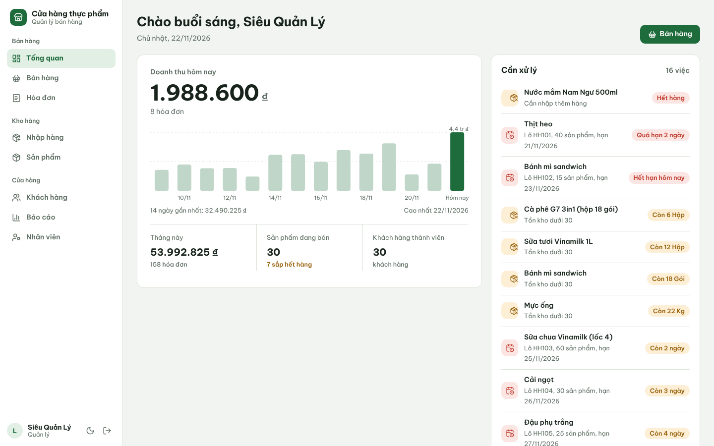 | 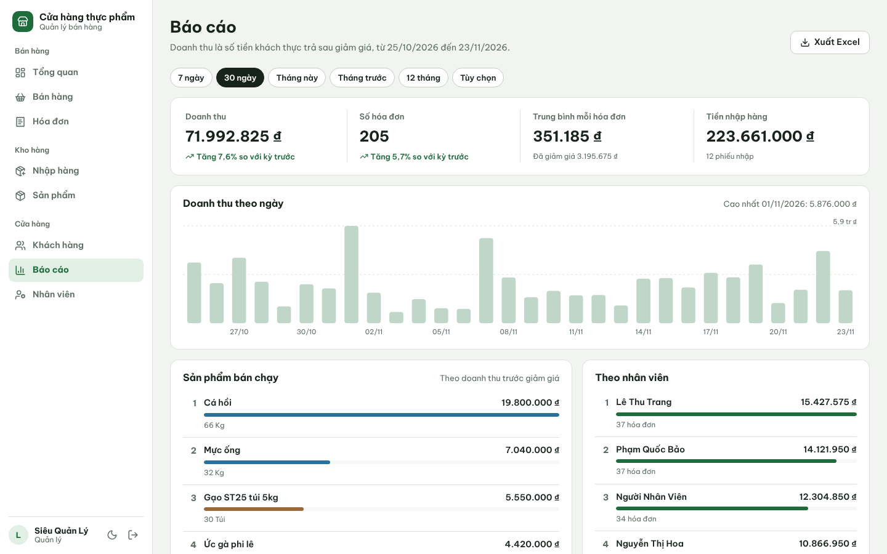 |
| **Lập phiếu nhập** | **Khách hàng** |
| 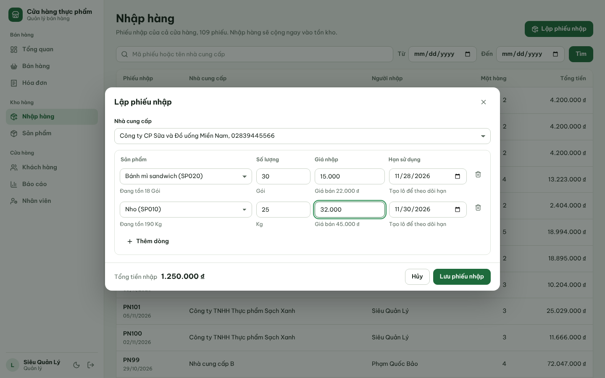 | 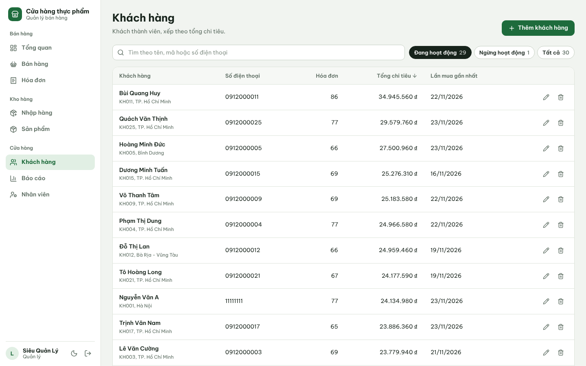 |
| **Chi tiết hóa đơn, in được** | **Chế độ tối** |
| 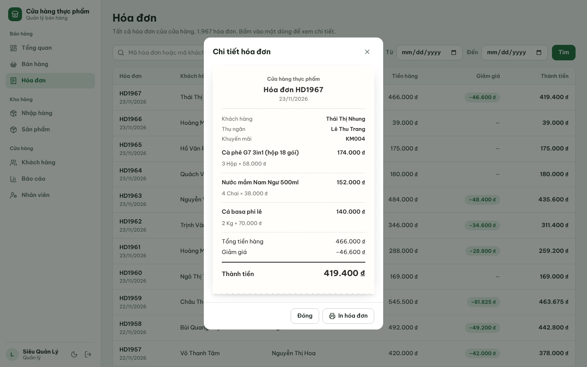 | 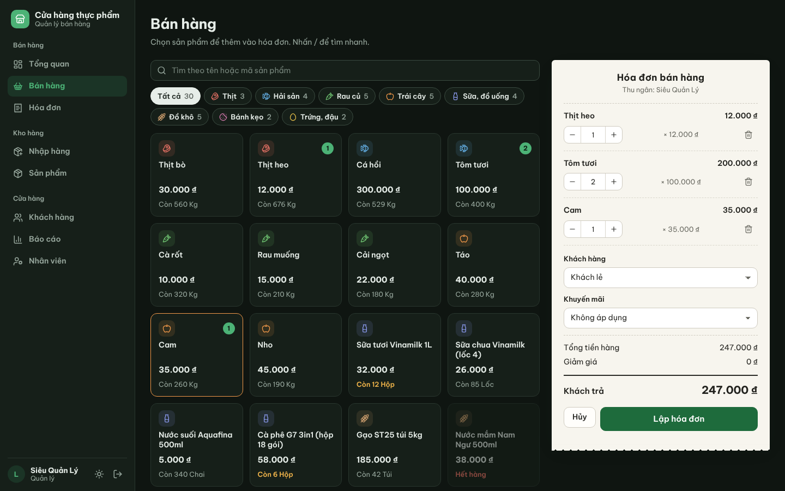 |

Trên điện thoại:

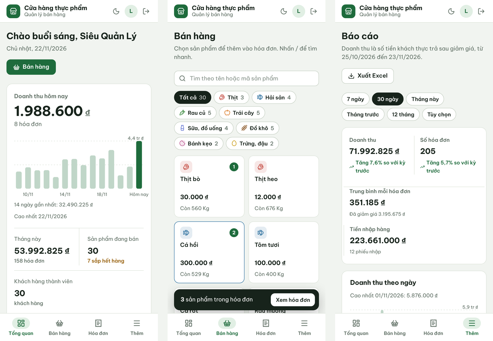

## Kiến trúc

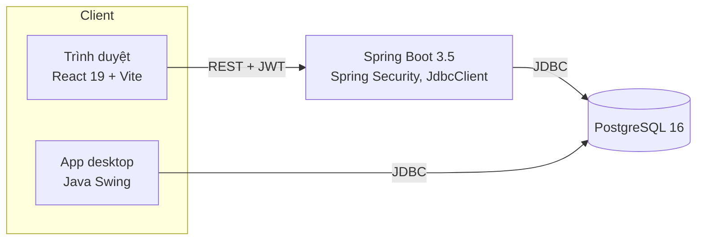

- Backend không dùng JPA để giữ nguyên schema có sẵn (mã dạng `HD123`, không có khóa tự tăng). SQL viết tay, mã mới sinh có khóa `pg_advisory_xact_lock` để hai người thao tác cùng lúc không bị trùng.
- "Hôm nay", "tháng này" luôn tính theo giờ Việt Nam dù database đặt ở UTC (như Neon).
- Chi tiết API, biến môi trường, cách chạy từng phần: [web/README.md](web/README.md). Tài liệu API gọi thử được ở `/swagger-ui.html`.

## Công nghệ

| Phần | Công nghệ |
| --- | --- |
| Backend | Java 17, Spring Boot 3.5, Spring Security (JWT HS256), JdbcClient, Bean Validation, springdoc-openapi |
| Frontend | React 19, TypeScript, Vite 8, React Router 7, lucide-react; biểu đồ SVG tự vẽ, không dùng thư viện |
| Desktop | Java Swing, FlatLaf, iText 5 (xuất PDF), JDBC |
| Database | PostgreSQL 16 (`unaccent` cho tìm không dấu, `pgcrypto`) |
| Kiểm thử | JUnit 5, MockMvc, Testcontainers; Vitest, Testing Library |
| Hạ tầng | Docker Compose, GitHub Actions, Render + Neon (gói miễn phí) |

## Chạy trên máy

Yêu cầu: **Docker Desktop**. Chạy bản desktop thì cần thêm **JDK 17 trở lên**.

```bash
git clone https://github.com/OwenDepTry/he-thong-quan-ly-cua-hang-thuc-pham
cd he-thong-quan-ly-cua-hang-thuc-pham

docker compose --profile web up -d --build   # bản web: http://localhost:8081
```

- Bản desktop: bấm đúp **`chay.bat`** (macOS/Linux: `./chay.sh`). Script tự đóng gói, bật PostgreSQL, chờ sẵn sàng rồi mở ứng dụng.
- Database mới tạo đã có dữ liệu mẫu tính tới hôm nay: 30 sản phẩm, 30 khách hàng, 7 nhân viên, 7 nhà cung cấp, khoảng 2.000 hóa đơn và 100 phiếu nhập trong 12 tháng, kèm vài sản phẩm sắp hết hàng và lô sắp hết hạn.
- Làm lại từ đầu với ngày tháng mới: `docker compose down -v` rồi chạy lại lệnh trên.

| Vai trò | Tài khoản | Mật khẩu |
| --- | --- | --- |
| Quản lý | `admin` | `admin` |
| Nhân viên | `nhanvien` | `123` |
| Nhân viên mẫu | `NV01`, `NV02`, `NV03` | `123` |
| Quản lý mẫu | `NV04` | `123` |

Deploy miễn phí lên Render + Neon: [web/DEPLOY.md](web/DEPLOY.md).

## Kiểm thử và CI

```bash
cd web/backend && mvn verify      # 48 test tích hợp, chạy PostgreSQL thật bằng Testcontainers (cần Docker)
cd web/frontend && npm test       # 17 test giao diện
```

Mỗi lần push, GitHub Actions chạy test backend, test và build frontend, đóng gói app desktop rồi thử đăng nhập bằng mật khẩu BCrypt trên database vừa nạp, và build Docker image.

## Những điều mình học được

- **Transaction và khóa dòng.** Lập hóa đơn phải trừ kho của nhiều sản phẩm cùng lúc. Mình khóa các dòng sản phẩm bằng `SELECT … FOR UPDATE` theo thứ tự mã để tránh deadlock, lỗi ở bất kỳ bước nào thì hủy cả hóa đơn.
- **Không tin dữ liệu từ trình duyệt.** Giá, tiền giảm, điều kiện khuyến mãi đều tính lại ở máy chủ; quyền kiểm tra ở API chứ không chỉ ẩn nút.
- **Đổi định dạng mật khẩu mà không làm hỏng dữ liệu cũ.** Chuyển từ mật khẩu thường sang BCrypt nhưng tài khoản cũ vẫn đăng nhập được, mật khẩu được mã hóa dần, và app desktop lẫn web đọc chung một định dạng.
- **Múi giờ.** Database trên Neon chạy giờ UTC nên "hôm nay" từ 0 đến 7 giờ sáng bị lệch ngày; backend tự tính ngày theo giờ Việt Nam.
- **Test với database thật.** Testcontainers dựng PostgreSQL và nạp đúng các file `sql/` như Docker Compose, nên test bắt được lỗi SQL mà mock không thấy.

## Cấu trúc thư mục

```
📦 he-thong-quan-ly-cua-hang-thuc-pham
 ┣ 📂 src
 ┃ ┣ 📂 config      kết nối CSDL (DBConnection)
 ┃ ┣ 📂 dao         truy vấn CSDL
 ┃ ┣ 📂 entity      lớp dữ liệu
 ┃ ┣ 📂 images      ảnh dùng trong giao diện
 ┃ ┣ 📂 main        Main.java, điểm khởi động
 ┃ ┗ 📂 org/mindrot/jbcrypt  BCrypt nhúng sẵn (giấy phép ISC)
 ┣ 📂 ui            giao diện Swing (màn hình, hộp thoại, thành phần dùng chung)
 ┣ 📂 sql           script tạo CSDL, dữ liệu mẫu, mã hóa mật khẩu (Docker tự nạp lần đầu, theo thứ tự tên)
 ┣ 📂 web
 ┃ ┣ 📂 backend     Spring Boot: API, bảo mật JWT, test Testcontainers
 ┃ ┗ 📂 frontend    React + Vite + TypeScript
 ┣ 📂 .github       GitHub Actions (test backend, frontend, desktop)
 ┣ 📂 lib           thư viện .jar (FlatLaf, PostgreSQL JDBC, iText)
 ┣ 📂 docs          ảnh chụp màn hình (web/ và desktop)
 ┣ 📄 docker-compose.yml     database (mặc định) + bản web (--profile web)
 ┣ 📄 render.yaml            cấu hình deploy Render
 ┣ 📄 chay.bat / chay.sh     chạy ứng dụng bằng 1 lần bấm
 ┣ 📄 nap-du-lieu-mau.bat    nạp dữ liệu mẫu vào database đang có
 ┗ 📄 build.bat / build.sh   đóng gói thành dist/QuanLyCuaHang.jar
```

## Bản desktop

App Swing chạy ở quầy, có thêm vài chức năng chưa có trên web: quản lý nhà cung cấp, chương trình khuyến mãi, thống kê theo năm và quý, xuất hóa đơn và phiếu nhập ra PDF.

| Trang chủ | Hóa đơn |
| --- | --- |
| 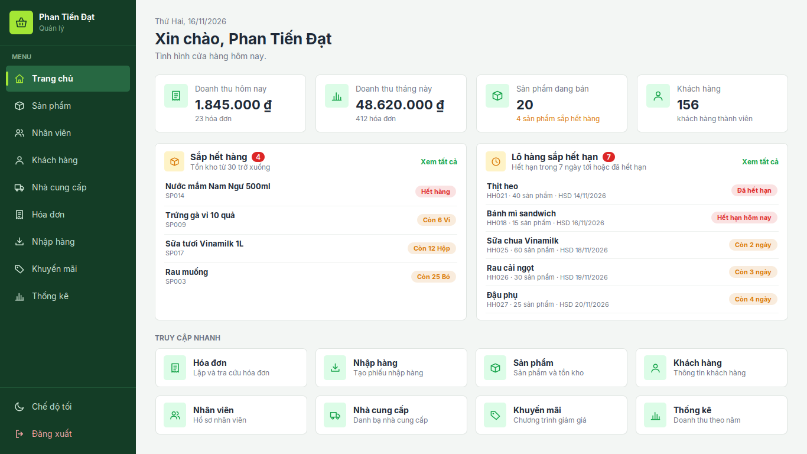 | 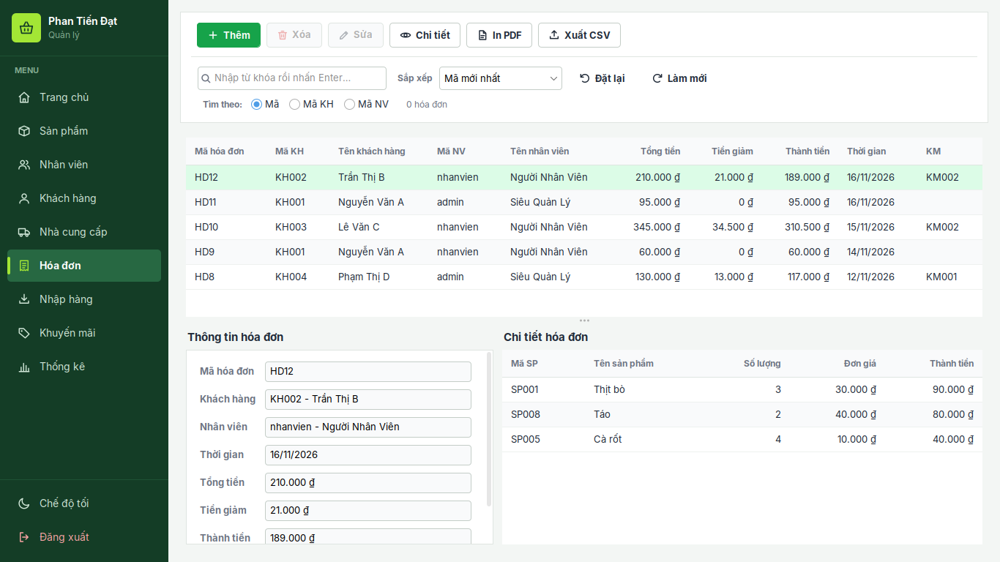 |
| **Thống kê** | **Chế độ tối** |
|  | 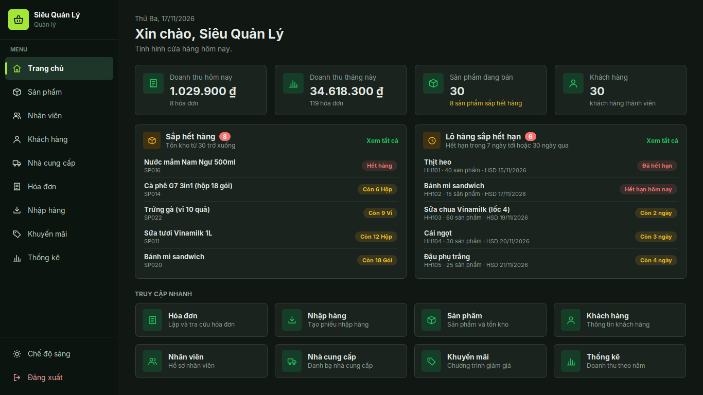 |

Chạy từ VS Code hoặc IDE:

1. Bật database: `docker compose up -d` (cổng **55432**, user và mật khẩu `postgres`).
2. Mở project, thêm các file trong `lib/` vào classpath (VS Code đã cấu hình sẵn `lib/**/*.jar`).
3. Chạy `src/main/Main.java`.

Muốn đổi kết nối thì chép `db.properties.example` thành `db.properties` rồi sửa (file này không bị đẩy lên GitHub). `build.bat` hoặc `./build.sh` đóng gói thành một file `dist/QuanLyCuaHang.jar` đã gộp sẵn thư viện.

Gặp lỗi kết nối, app sẽ ghi rõ nguyên nhân. Hay gặp nhất: Docker Desktop chưa mở (mở rồi chạy `docker compose up -d`), hoặc trùng cổng 55432 (đổi cổng trong `docker-compose.yml` và tạo `db.properties` dùng cổng đó).

## Hướng phát triển

- Quét mã vạch khi bán hàng
- Thanh toán chuyển khoản bằng mã QR
- Đưa quản lý nhà cung cấp và khuyến mãi lên bản web
- Phân quyền chi tiết hơn (thủ kho, thu ngân)

## Nguồn ảnh

Ảnh minh họa của 30 sản phẩm mẫu là ảnh thật trên [Wikimedia Commons](https://commons.wikimedia.org/), dùng theo giấy phép tự do của từng ảnh (phạm vi công cộng, CC0, CC BY, CC BY-SA, GFDL). Tác giả và đường dẫn tới trang ảnh nằm trong `sql/zzzz_anh_san_pham.sql`, và hiện ngay trong ứng dụng (trang Sản phẩm, mục "Xem nguồn ảnh"). Ảnh được hiển thị trực tiếp từ Commons, không chép vào repo.

## Tác giả

**Phan Tiến Đạt**, [@OwenDepTry](https://github.com/OwenDepTry). Góp ý và báo lỗi qua [Issues](https://github.com/OwenDepTry/he-thong-quan-ly-cua-hang-thuc-pham/issues).
